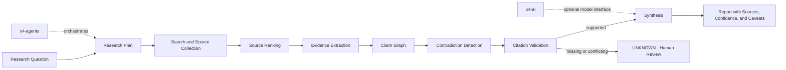

# x4-research

**Evidence-first research agent**

Claim graphs • Source ranking • Contradiction detection • Citation validation

[](LICENSE)
[](CHANGELOG.md)

Part of **[ARIEX4Ops / X4](https://github.com/dhe-cruzer69)**.

---

## Principle

Every important claim must carry source, evidence, confidence, and contradiction checks.

```
QUESTION
  ↓
PLANNER → SEARCH → SOURCE RANKING
  ↓
EVIDENCE EXTRACTION → CLAIM GRAPH
  ↓
CONTRADICTION DETECTION → CITATION VALIDATION
  ↓
SYNTHESIS → REPORT
```

<!-- X4-APEX-DIAGRAM-START:x4-research -->



<!-- X4-APEX-DIAGRAM-END:x4-research -->

## Related

- [x4-agents](https://github.com/dhe-cruzer69/x4-agents)
- [x4-ai](https://github.com/dhe-cruzer69/x4-ai)

## License

Apache-2.0

## Support

**[GitHub Sponsors](https://github.com/sponsors/dhe-cruzer69)**
